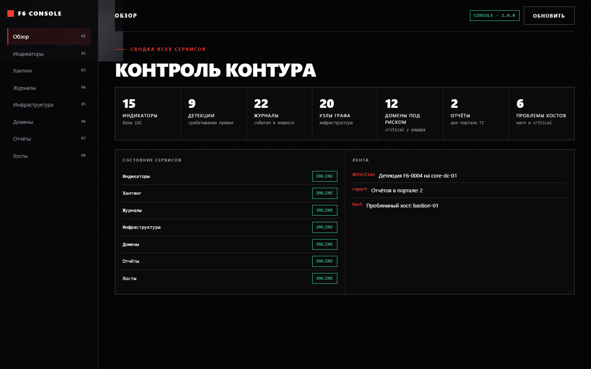
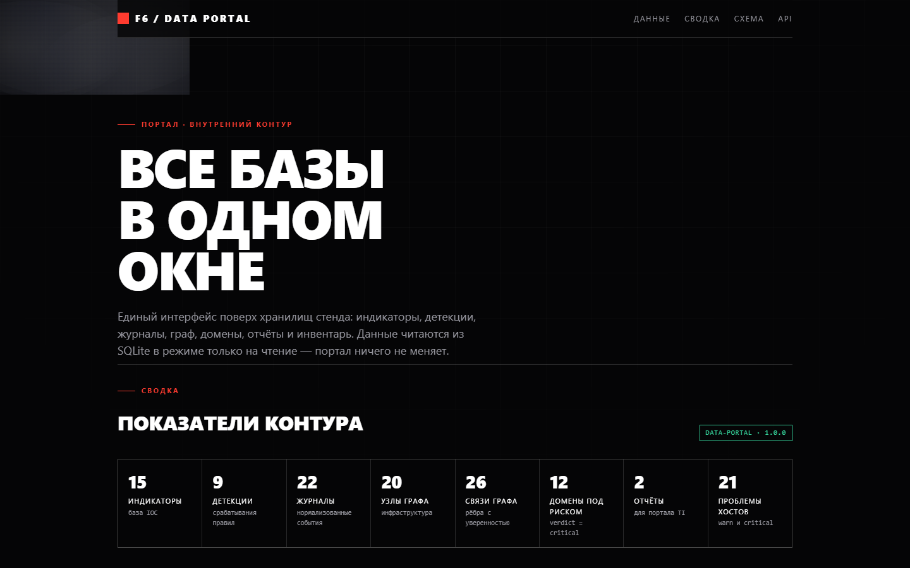
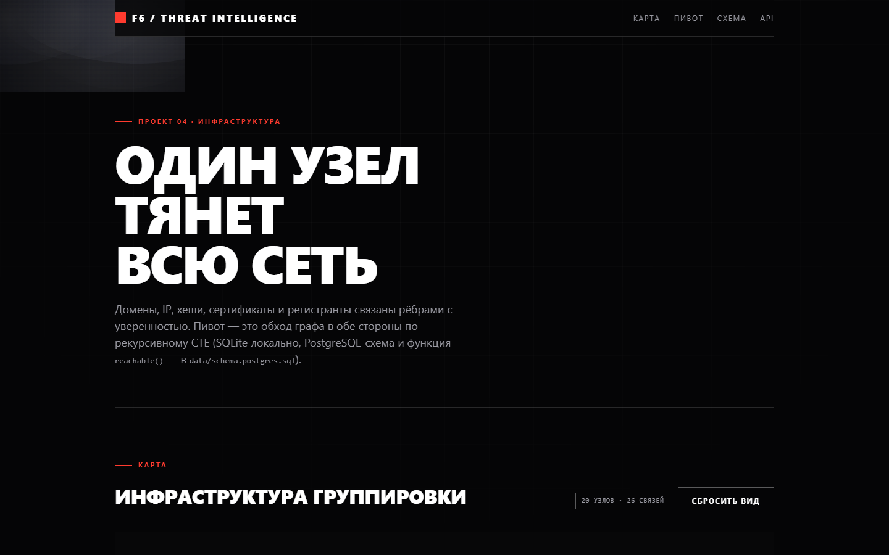

# F6 Threat Intelligence — учебный стенд

Восемь сервисов под задачи команды Threat Intelligence из вакансии F6 — плюс два приложения поверх них:
портал-обозреватель баз и консоль, которая собирает все бизнес-разделы через API сервисов.
У каждого проекта — бэкенд на FastAPI, фронтенд без сборки, тесты и собственные данные.

## Быстрый старт

```powershell
python -m venv .venv
.\.venv\Scripts\python.exe -m pip install -r requirements.txt
.\run-all.ps1
```

Портфолио: <http://127.0.0.1:8200/site/> · остановка: `.\stop-all.ps1` (гасит только те процессы, что поднял запуск).

| Порт | Сервис | Что делает |
| --- | --- | --- |
| 8200 | site | портфолио стенда в стиле F6 |
| 8201 | Feed Harvester | парсинг CSV/JSON/TXT-фидов, деобфускация, SQLite |
| 8202 | Hunt Rules | DSL правил хантинга на YAML, прогон по событиям |
| 8203 | Log Forge | нормализация syslog/nginx/Windows, поиск по индексу |
| 8204 | Botnet Map | граф инфраструктуры, пивот через рекурсивный CTE |
| 8205 | Typosquat Radar | генерация и скоринг похожих доменов |
| 8206 | Report Builder | Markdown/HTML-отчёты по шаблонам |
| 8207 | Ops Agent | инвентарь, метрики, чек-листы укрепления Linux/Windows |
| 8209 | Data Portal | все базы стенда: сводка, дерево таблиц, поиск, CSV (только чтение) |
| 8210 | Console | приложение по бэкендам: 8 бизнес-разделов через API сервисов |

Тесты запускаются внутри папки проекта:

```powershell
cd 03-log-forge
..\.venv\Scripts\python.exe -m pytest . -q
```

## Структура

```
f6-portfolio/
├── site/                  портфолио-сайт
├── shared/                дизайн-система: f6.css, clouds.js, api.js
├── lint/check_style.py    AST-чекер правил стиля
├── ruff.toml, .pylintrc   конфигурация линтеров
├── run-all.ps1, stop-all.ps1
└── 01-… 09-…              сервисы: app/, frontend/, data/, tests/, run.ps1
```

## Правила кода (линтер)

Команда в вакансии задаёт три ограничения — стенд им подчинён целиком:

1. **Один выход из функции.** Ровно один `return`; вложенные ветки выражаются выражением, а не ранним выходом.
2. **Функции в 1–2 инструкции.** Крупные шаги собираются композицией мелких функций.
3. **Запрещены `while`, `break`, `continue`.** Обходы — генераторы, рекурсия или рекурсивный CTE в базе.

Проверяется тремя инструментами:

```powershell
.\.venv\Scripts\python.exe lint\check_style.py .      # F6S001/F6S002/F6S003
.\.venv\Scripts\python.exe -m ruff check .             # E/F/W/I/N/UP/B/RET/C4
.\.venv\Scripts\python.exe -m pylint --rcfile=.pylintrc 01-feed-harvester/app
```

`lint/check_style.py` — собственный чекер на `ast`: он считает инструкции в теле функции, `return`
(не заходя во вложенные функции) и ищет запрещённые узлы. Тесты из проверки исключены: фикстуры pytest
пишутся в обычном стиле.

## Стиль интерфейса

Взят с сайта компании: чёрное поле, крупная белая типографика в верхнем регистре, тонкие линии, один
сигнальный красный акцент и сдержанные анимации. Плюс анимация облаков — мягкие световые пятна на canvas,
которые медленно дрейфуют по фону (`shared/clouds.js`, отключается при `prefers-reduced-motion`).

## Тесты

**290 тестов** в девяти наборах pytest — по сервису на набор, без общих фикстур между проектами.

| Сервис | Тестов | Что покрыто |
| --- | --- | --- |
| 01 Feed Harvester | 42 | деобфускация, типы индикаторов, CSV/JSON/TXT, апсерт и слияние тегов, фильтры |
| 02 Hunt Rules | 41 | матчеры (glob, regex, списки), режимы all/any, YAML-разбор, прогон и replay |
| 03 Log Forge | 35 | syslog/nginx/Windows, инвертированный индекс, IDF-ранжирование, агрегаты |
| 04 Botnet Map | 23 | рекурсивный обход в обе стороны, глубина, подграф, пивот, PostgreSQL-схема |
| 05 Typosquat Radar | 41 | восемь техник генерации, Левенштейн, веса риска, вердикты, watchlist |
| 06 Report Builder | 43 | Markdown-конвертер, секции отчёта, шаблоны, выгрузка, метрики |
| 07 Ops Agent | 37 | пороги всех шести метрик, чек-листы, инвентарь, журнал, 404 |
| 08 Data Portal | 15 | реестр баз, пагинация, поиск по колонкам, сортировка, CSV, 404 |
| 09 Console | 13 | сборка сводки, проксирование разделов, деградация при offline |

Прогон по всем сразу:

```powershell
Get-ChildItem -Directory -Filter "0*" | ForEach-Object {
    Push-Location $_.FullName
    ..\.venv\Scripts\python.exe -m pytest . -q
    Pop-Location
}
```

## Витрина

Скриншоты и GIF-демонстрации сняты с работающего стенда через Playwright (Chromium): `docs/screens/` и
`docs/gifs/`, страница-витрина — <http://127.0.0.1:8200/docs/>.







Пересъёмка одной командой (стенд должен быть запущен):

```powershell
.\.venv\Scripts\python.exe tools\capture.py
```

Скрипт отключает на время съёмки `backdrop-filter` и анимации, чтобы кадры были стабильными.

## Про данные

Всё содержимое стенда синтетическое: IP-адреса только из документационных диапазонов RFC 5737
(`192.0.2.0/24`, `198.51.100.0/24`, `203.0.113.0/24`), домены — на `example.*`, хеши и события выдуманы.
Никаких образцов вредоносного кода, реальных инфраструктур или чужих персональных данных в репозитории нет:
сервисы демонстрируют обработку и представление данных, а не готовые средства атаки.

## Соответствие вакансии

| Требование | Где закрыто |
| --- | --- |
| Python: парсеры, автоматизация | все сервисы, 7 наборов тестов (около 130 проверок) |
| Linux и Windows как администратор | Log Forge (syslog и события Windows), Ops Agent (hardening-чек-листы) |
| SQL: sqlite, postgres, mysql/mariadb | SQLite в каждом сервисе; PostgreSQL-схема и `reachable()` в Botnet Map |
| elasticsearch/opensearch | Log Forge: инвертированный индекс, маппинг полей, ранжирование по IDF |
| Разведка угроз, правила хантинга | Hunt Rules, Feed Harvester, Botnet Map |
| Отчёты для портала и соцсетей | Report Builder |
| Администрирование серверов команды | Ops Agent |
